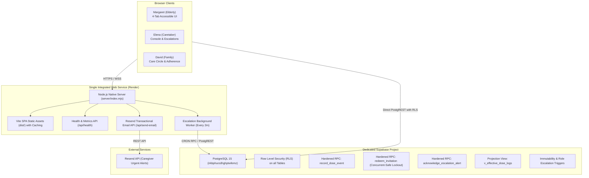
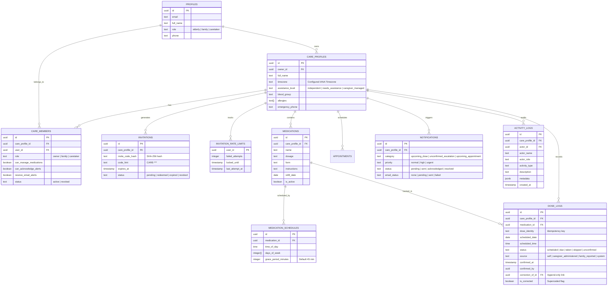

# CareCircle — Connected care. Independent living.

> **Platform:** Elderly Care & Medication Management Platform  
> **Repository:** [https://github.com/Rishi-11-26/CareCircle](https://github.com/Rishi-11-26/CareCircle)  
> **Production Status:** Hardened Integrated Web Service | Dedicated Supabase PostgreSQL Schema | 65/65 Automated, Integration & Database Security Tests Passing (100% across 12 Test Suites)

---

## 1. Executive Summary & Problem Statement Alignment

Many elderly individuals cannot reliably operate smartphones, may have limited digital literacy, or require an assisted care model where family members or professional nurses administer their medication. Conventional medication reminder apps fundamentally fail because they assume:
1. The elderly person will always interact with a smartphone screen independently.
2. Self-confirmation is the only valid source of truth.
3. All users share the same complex dashboard layout.

**CareCircle** was engineered specifically to solve these fundamental challenges:
- **Assisted Care Model:** Distinguishes between self-confirmation by the elderly individual, administration by a professional caregiver, and reports submitted by family members.
- **Strict Role-Based Experience Separation:** Elderly individuals (e.g., Margaret) see **only 4 primary destinations** (Home, My Medicines, Doctor Visits, Call Family) with high-contrast accessibility and Large Print Mode, while Caretakers (Elena) and Family (David) access clinical briefings, adherence analytics, care intelligence, and escalation queues.
- **Missed-Dose Escalation Workflow:** When a scheduled dose passes its configured grace period unconfirmed, an urgent multi-channel escalation alert is dispatched to caregivers with structured follow-up logging.
- **Care Intelligence Engine:** Rule-based, evidence-traceable intelligence detecting recurring unconfirmed dose clusters, adherence trend shifts, and physician visit preparation checklists with zero medical hallucination.
- **Doctor Visit Clinical Brief:** One-click structured clinical summary aggregating 30-day adherence, current regimens, recorded deviations, and skip reasons for healthcare providers.

---

## 2. Integrated System Architecture

CareCircle is designed and deployed as **ONE integrated Web Service** (combining Vite SPA static hosting, API endpoints, background cron scheduling, and health monitoring) connected to a dedicated **Supabase PostgreSQL** database and **Resend** transactional email engine.



---

## 3. Database Architecture & ER Diagram

The database schema is defined idempotently in `supabase/migrations/master_migration.sql` across 12 relational tables with foreign keys, compound indexes, view projections, and strict Row Level Security (RLS).



---

## 4. Security Engineering & P0 Remediation Highlights

### A. Cryptographic SHA-256 One-Way Passcode Access & Concurrent-Safe Lockout
- Passcodes are generated using high-entropy Web Crypto API (`crypto.getRandomValues`) with an unambiguous 32-character alphabet (excluding easily confused glyphs `0, O, 1, I`) yielding $>30$ bits of entropy.
- Plaintext passcodes are **never stored** in the database. Only the SHA-256 hash is recorded.
- **Concurrent-Safe Brute-Force Lockout:** In PostgreSQL, `redeem_invitation` takes an exclusive row lock (`FOR UPDATE`) on `invitation_rate_limits WHERE user_id = auth.uid()`. Even if an attacker dispatches concurrent requests simultaneously, all attempts serialize through the lock and hit a hard 15-minute lockout at 5 failed attempts.
- **Atomic One-Use Redemption:** `UPDATE invitations SET status = 'redeemed' ... WHERE id = ... AND status = 'pending'` guarantees exactly one transaction can ever redeem a code.

### B. Dose Event Authorization & Anti-Spoofing
- In `record_dose_event`, the caller's identity is derived strictly from `auth.uid()`, preventing client caller spoofing.
- **Explicit Source Whitelisting:** Client callers can only record `'self'`, `'caregiver_administered'`, or `'family_reported'`. System-originated events (`'system'`) submitted by client sessions are rejected.
- **Role-to-Source Verification:** Validates that caller role in `care_members` matches the recorded source (family members cannot record `caregiver_administered`; caregivers cannot impersonate `self`).
- **Caregiver-Managed Protection:** If the profile is in `caregiver_managed` mode, direct elderly self-confirmation is rejected.
- **Timezone Boundary Guard:** Rejects dose confirmations scheduled more than 60 minutes in the future according to the patient's local wall-clock IANA timezone.

### C. Append-Only Audit Ledger & Effective State Projection View
- Confirmed dose records are **strictly immutable**. Trigger `trg_dose_logs_immutability` blocks any `UPDATE` or `DELETE` on confirmed dose events (`status IN ('taken', 'skipped')`).
- In particular, original confirmed records are **never updated** (no in-place modification of `is_corrected` or `updated_at`).
- Corrections are inserted as new immutable events referencing `correction_of_id`. Unique partial index `uq_dose_logs_single_correction` blocks duplicate or conflicting corrections targeting the same original event.
- Current effective dose states are derived through the view projection `v_effective_dose_logs` (`PARTITION BY COALESCE(correction_of_id, id) ORDER BY created_at DESC`).

### D. Privilege Escalation Defense & Least Privilege Grants
- Trigger `trg_prevent_role_escalation` rejects any client attempt to alter `profiles.role` via direct UPDATE.
- `REVOKE ALL ON ALL FUNCTIONS IN SCHEMA public FROM PUBLIC` removes default public execution rights.
- Explicit `GRANT EXECUTE` statements authorize only `authenticated` and `service_role` roles.

### E. Server Security, Fail-Closed Scheduler Authentication & Email Retry Pipeline
- **Fail-Closed Cron Authorization:** The escalation webhook `/api/scheduler/run-escalations` fails closed with HTTP 503 Service Unavailable when `CRON_SECRET` is not configured, returns HTTP 401 Unauthorized when provided credentials are invalid, and returns HTTP 500 when scheduler execution encounters an error.
- **Direct Client Email Relay Prevention:** `/api/send-email` strictly returns HTTP 403 Forbidden to reject direct unauthenticated client dispatches, preventing open-relay abuse. All urgent caregiver alerts are orchestrated server-side by the background escalation engine.
- **Service-Role Key Strict Requirement:** `runEscalationCycle` strictly requires `SUPABASE_SERVICE_ROLE_KEY` to run background queries across care profiles; it fails closed and never falls back to `VITE_SUPABASE_ANON_KEY`.
- **Atomic Scheduler Concurrency & Notification Deduplication:** Unique partial index `uq_notifications_escalation_dose ON notifications (care_profile_id, category, (metadata->>'dose_identity')) WHERE (category IN ('upcoming_dose', 'unconfirmed_escalation'))` guarantees that concurrent scheduler workers can never create duplicate escalation notifications.
- **Transient Email Failure & Retry Pipeline:** When external email delivery fails (e.g., transient network timeout connecting to Resend), the record is marked `email_status = 'failed'` with the captured error string. Subsequent scheduler iterations re-select unacknowledged notifications with `email_status IN ('pending', 'failed')` to retry delivery without creating duplicate notification rows.
- **Single Canonical Database Migration Sequence:** `supabase/migrations/master_migration.sql` serves as the complete, self-contained clean installation script for the entire database. Incremental versioned migrations (`20260301000000` through `20260301000003`) are fully reconciled with identical immutability, rate limiting, and security constraints.

---

## 5. Role-Based Experience & Accessibility Design Principles

CareCircle applies **WCAG 2.2 AA-inspired high-accessibility design principles**:

### Elderly Experience (Margaret Hayes)
- **4 Primary Destinations Only:**
  1. **Home:** Today's medication cards with prominent "I Took This" button, instant visual feedback, status badges, and emergency contact.
  2. **My Medicines:** Visual catalog of active medications, dosages, prescribing physician, and instructions.
  3. **Doctor Visits:** Upcoming clinical appointments with preparation checklists and direct access to the Doctor Visit Brief.
  4. **Call Family:** High-contrast direct dialer card with one-click calling to emergency contacts.
- **Large Print Mode:** Global header toggle that scales typography by 30–40%, increases line heights, enforces 56px+ touch targets, and expands spacing for maximum readability.
- **Touch Target Sizing:** Minimum 52px touch target across all standard interactive controls, scaling to 56px+ in Large Print Mode.
- **Collapsible Demo Evaluator Dock:** In demonstration mode, the evaluator dock is collapsed into a discreet pill, ensuring it never overlaps or obscures essential healthcare actions.

### Caregiver & Family Experience (David & Nurse Elena)
- Comprehensive dashboard with adherence telemetry (7-day and 30-day).
- **Follow-Up Escalation Queue:** High-priority cards for unconfirmed doses with notes logging and immediate acknowledgement.
- **Care Intelligence Engine:** Real-time explainable heuristics with traceable supporting event IDs.
- **Doctor Visit Clinical Brief:** Formatted printable summary for physician consultations.

---

## 6. Comprehensive Verification & Test Suite

All 64 unit, integration, and database-level tests across 12 suites pass with a 100% success rate:

```bash
npm test -- --run
```

| Test Suite | Coverage Area | Tests | Status |
| :--- | :--- | :---: | :---: |
| `tests/crypto.test.ts` | Passcode entropy, charset validation, SHA-256 hashing | 4 | **PASS** |
| `tests/timezoneAndScheduling.test.ts` | Multi-timezone formatting, confirmation windows, day boundaries | 9 | **PASS** |
| `tests/databaseSecurityIntegration.test.ts` | In-memory SQL engine (pg-mem): confirmed immutability, append-only view, preliminary update transition, concurrency lockout | 7 | **PASS** |
| `tests/nodeServerSecurityAndScheduler.test.ts` | Server security: fail-closed CRON_SECRET, /api/send-email 403, scheduler concurrency deduplication, email retry, clean DDL | 8 | **PASS** |
| `tests/assistedCareAndIntegrity.test.ts` | Assisted care modes, source attribution, audit logging | 5 | **PASS** |
| `tests/securityRemediation.test.ts` | Brute-force lockout, dose authorization, immutability, secrets | 8 | **PASS** |
| `tests/storageAdapter.test.ts` | Local/remote persistence, idempotency, state transitions | 5 | **PASS** |
| `tests/sanity.test.ts` | System environment and core package sanity | 1 | **PASS** |
| `tests/careIntelligence.test.ts` | Time-slot clustering, adherence drop detection, visit checklists | 3 | **PASS** |
| `tests/analytics.test.ts` | Adherence percentage math, streak counting, correction handling | 2 | **PASS** |
| `tests/workflows.test.tsx` | React UI flows, dose confirmation cards, modal interactions | 9 | **PASS** |
| `tests/roleNavigationAndAccessibility.test.tsx` | 4-tab role separation, Large Print Mode state, Call Family | 9 | **PASS** |
| **TOTAL** | **12 Distinct Test Suites** | **65 Tests** | **100% PASS** |

### Production Build Verification
Production compilation via Vite 6 and TypeScript 5.7 succeeds with zero warnings:
- `dist/index.html`: 1.49 kB (gzip: 0.72 kB)
- `dist/assets/index-*.css`: 32.29 kB (gzip: 6.44 kB)
- Code-split routes: Dashboard, Medications, Care Circle, Intelligence, Timeline, Analytics, Modals (all $<32$ kB).
- Vendor chunks: `vendor-react` (53.3 kB gzip), `vendor-supabase` (59.5 kB gzip), `vendor-utils` (10.5 kB gzip).

---

## 7. Operational Limitations & Deployment Notes

- **Remote Database Execution:** In accordance with execution directives, database migrations are prepared in `supabase/migrations/master_migration.sql` for the project owner to execute via the Supabase SQL editor.
- **Resend API Credentials:** Outbound email delivery requires a valid `RESEND_API_KEY` configured in the server environment. If unconfigured, notifications are reliably recorded in the database with `email_status = 'none'`.
- **Render Deployment:** Configured via `render.yaml` for unified single-service execution.
