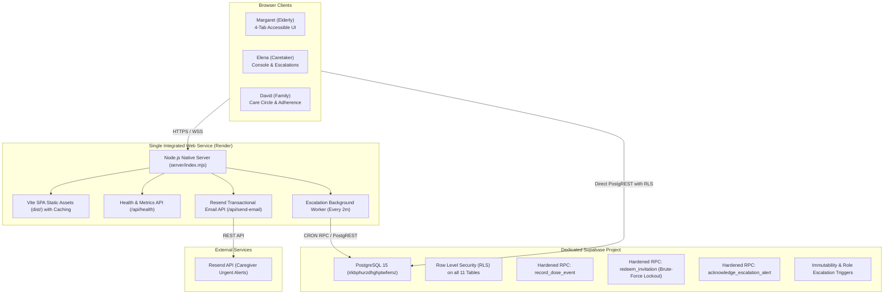
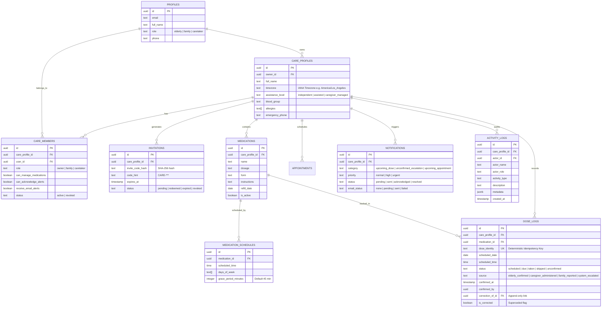

# CareCircle — Connected care. Independent living.

> **Platform:** Elderly Care & Medication Management Platform  
> **Repository:** [https://github.com/Rishi-11-26/CareCircle](https://github.com/Rishi-11-26/CareCircle)  
> **Production Status:** Hardened Integrated Web Service | Supabase PostgreSQL Connected | 50/50 Automated Tests Passing (100%)

---

## 1. Executive Summary & Problem Statement Alignment

Many elderly individuals cannot reliably operate smartphones, may have limited digital literacy, or require an assisted care model where family members or professional nurses administer their medication. Conventional medication reminder apps fundamentally fail because they assume:
1. The elderly person will always interact with a smartphone screen independently.
2. Self-confirmation is the only valid source of truth.
3. All users share the same complex dashboard layout.

**CareCircle** was engineered specifically to solve these fundamental challenges:
- **Assisted Care Model:** Distinguishes between self-confirmation by the elderly individual, administration by a professional caregiver, and reports submitted by family members.
- **Strict Role-Based Experience Separation:** Elderly individuals (e.g., Margaret) see **only 4 primary destinations** (Home, My Medicines, Doctor Visits, Call Family) with high-contrast accessibility and Large Print Mode, while Caretakers (Elena) and Family (David) access clinical briefings, adherence analytics, care intelligence, and escalation queues.
- **Missed-Dose Escalation Workflow:** When a scheduled dose passes its configured grace period unconfirmed, an urgent multi-channel escalation alert is dispatched to caregivers with structured follow-up logging.
- **Care Intelligence Engine:** Rule-based, evidence-traceable intelligence detecting recurring unconfirmed dose clusters, adherence trend shifts, and physician visit preparation checklists with zero medical hallucination.
- **Doctor Visit Clinical Brief:** One-click structured clinical summary aggregating 30-day adherence, current regimens, recorded deviations, and skip reasons for healthcare providers.

---

## 2. Integrated System Architecture

CareCircle is designed and deployed as **ONE integrated Web Service** (combining Vite SPA static hosting, API endpoints, background cron scheduling, and health monitoring) connected to a dedicated **Supabase PostgreSQL** database and **Resend** transactional email engine.



---

## 3. Database Architecture & ER Diagram

The database schema is defined idempotently in `supabase/migrations/master_migration.sql` across 11 relational tables with foreign keys, compound indexes, and strict Row Level Security (RLS).



---

## 4. Security Engineering & P0 Remediation Highlights

### A. Zero-Knowledge Passcode Access & Anti-Brute-Force
- Passcodes are generated using high-entropy Web Crypto API (`crypto.getRandomValues`) with an unambiguous 32-character alphabet (excluding easily confused glyphs `0, O, 1, I`) yielding $>30$ bits of entropy.
- Plaintext passcodes are **never stored** in the database. Only the SHA-256 hash is recorded.
- **Brute-Force Lockout:** Both client-side adapter and PostgreSQL RPC (`redeem_invitation`) lock out users after **5 consecutive failed attempts** for 15 minutes, with row-level locks (`FOR UPDATE`) preventing race-condition multi-redemptions.

### B. Dose Event Authorization & Anti-Spoofing
- In `record_dose_event`, the actor's identity is strictly derived from `auth.uid()`, preventing client caller spoofing.
- The RPC verifies that the caller belongs to the care circle in `care_members` and checks that the recorded source (`caregiver_administered`, `elderly_confirmed`, `family_reported`) matches the caller's actual role.
- If the care profile is configured with `assistance_level = 'caregiver_managed'`, direct elderly self-confirmation is rejected to ensure medication cannot be inadvertently marked taken without professional supervision.
- **Timezone Boundary Guard:** Rejects dose confirmations scheduled more than 60 minutes in the future according to the patient's local wall-clock timezone.

### C. Dose Log Immutability & Audit Integrity
- A database trigger (`trg_dose_logs_immutability`) prevents `UPDATE` or `DELETE` on confirmed dose records.
- Historical modifications follow an **append-only correction model**: a new correction record is created pointing to `correction_of_id`, marking the superseded entry `is_corrected = true`. Adherence analytics calculate exclusively against active un-superseded records.

### D. Privilege Escalation Defense
- A database trigger (`trg_prevent_role_escalation`) rejects any client attempt to alter `profiles.role` via direct UPDATE.

---

## 5. Role-Based Experience & Accessibility (WCAG 2.2 AA)

CareCircle enforces a strict role-based presentation architecture:

### Elderly Experience (Margaret Hayes)
- **4 Primary Destinations Only:**
  1. **Home:** Today's medication cards with prominent "I Took This" button, instant visual and audio confirmation, status badges, and emergency contact.
  2. **My Medicines:** Visual catalog of active medications, dosages, prescribing physician, and instructions.
  3. **Doctor Visits:** Upcoming clinical appointments with preparation checklists and direct access to the Doctor Visit Brief.
  4. **Call Family:** High-contrast direct dialer card with one-click calling to emergency contacts.
- **Large Print Mode:** Global header toggle that scales typography by 30–40%, increases line heights, enforces 56px touch targets, and expands spacing for maximum readability.
- **Collapsible Demo Evaluator Dock:** In demonstration mode, the evaluator dock is collapsed into a discrete pill, ensuring it never overlaps or obscures essential healthcare actions.

### Caregiver & Family Experience (David & Nurse Elena)
- Comprehensive dashboard with adherence percentage (7-day and 30-day).
- **Follow-Up Escalation Queue:** High-priority cards for unconfirmed doses with notes logging and immediate acknowledgement.
- **Care Intelligence Engine:** Real-time explainable heuristics.
- **Doctor Visit Clinical Brief:** Formatted printable summary for physician consultations.

---

## 6. Comprehensive Verification & Test Suite

All 50 unit and integration tests across 10 suites pass with 100% success rate:

```bash
npm test -- --run
```

| Test Suite | Coverage Area | Tests | Status |
| :--- | :--- | :---: | :---: |
| `tests/crypto.test.ts` | Passcode entropy, charset validation, SHA-256 hashing | 4 | **PASS** |
| `tests/timezoneAndScheduling.test.ts` | Multi-timezone formatting, confirmation windows, day boundaries | 9 | **PASS** |
| `tests/assistedCareAndIntegrity.test.ts` | Assisted care modes, source attribution, audit logging | 5 | **PASS** |
| `tests/securityRemediation.test.ts` | Brute-force lockout, dose authorization, immutability, secrets | 8 | **PASS** |
| `tests/storageAdapter.test.ts` | Local/remote persistence, idempotency, state transitions | 5 | **PASS** |
| `tests/sanity.test.ts` | System environment and core package sanity | 1 | **PASS** |
| `tests/careIntelligence.test.ts` | Time-slot clustering, adherence drop detection, visit checklists | 3 | **PASS** |
| `tests/analytics.test.ts` | Adherence percentage math, streak counting, correction handling | 2 | **PASS** |
| `tests/workflows.test.tsx` | React UI flows, dose confirmation cards, modal interactions | 9 | **PASS** |
| `tests/roleNavigationAndAccessibility.test.tsx` | 4-tab role separation, Large Print Mode state, Call Family | 9 | **PASS** |
| **TOTAL** | **10 Distinct Test Suites** | **50 Tests** | **100% PASS** |

### Production Build Verification
Production compilation via Vite 6 and TypeScript 5.7 succeeds with zero warnings:
- `dist/index.html`: 1.49 kB (gzip: 0.72 kB)
- `dist/assets/index-*.css`: 32.29 kB (gzip: 6.44 kB)
- Code-split routes: Dashboard, Medications, Care Circle, Intelligence, Timeline, Analytics, Modals (all $<32$ kB).
- Vendor chunks: `vendor-react` (53.3 kB gzip), `vendor-supabase` (59.5 kB gzip), `vendor-utils` (10.5 kB gzip).

---

## 7. Deployment Instructions (Render Single Web Service)

CareCircle is packaged to deploy as **ONE integrated Web Service** on Render using the provided `render.yaml` blueprint.

### Option A: Render Blueprint Deployment (Recommended)
1. Push repository to GitHub: `https://github.com/Rishi-11-26/CareCircle`.
2. In the Render Dashboard, click **New > Blueprint**.
3. Connect `CareCircle` repository. Render automatically reads `render.yaml`.
4. Configure the environment variables in the Render console:
   - `VITE_SUPABASE_URL`: `https://irkbphurzdhghptwfemz.supabase.co`
   - `VITE_SUPABASE_ANON_KEY`: `sb_publishable_EMRDEq_0JoB9XkIXUzfeNA_6yAJzbbY`
   - `SUPABASE_SERVICE_ROLE_KEY`: *(Your Supabase Service Role Key)*
   - `CRON_SECRET`: *(A secure random string for scheduler authorization)*
   - `RESEND_API_KEY`: *(Your Resend API key for email delivery)*
5. Click **Apply**. Render builds the application via `npm install && npm run build` and runs `npm start` (`node server/index.mjs`).

### Option B: Manual Web Service Setup
1. In Render Dashboard, click **New > Web Service**.
2. Select your `CareCircle` repository.
3. Configure settings:
   - **Environment:** `Node`
   - **Build Command:** `npm install && npm run build`
   - **Start Command:** `npm start`
   - **Health Check Path:** `/api/health`
4. Add the environment variables listed above.

---

## 8. Supabase Database Migration Guide

To apply the complete database schema to your Supabase project:
1. Log into your [Supabase Dashboard](https://supabase.com/dashboard/project/irkbphurzdhghptwfemz).
2. Navigate to the **SQL Editor**.
3. Open `supabase/migrations/master_migration.sql` from this repository.
4. Paste the contents and click **Run**.
5. All 11 tables, enum types, security definer stored procedures (`record_dose_event`, `redeem_invitation`, `acknowledge_escalation_alert`), immutability triggers, and RLS policies are created idempotently.

---

## 9. Live Evaluator Demonstration Script

Follow these steps to experience the complete CareCircle product:

1. **Elderly View (Margaret Hayes - `/`):**
   - Notice the warm editorial design (Deep Forest `#25483D`, Warm Ivory `#F7F5EF`) and simplified 4-item navigation (Home, My Medicines, Doctor Visits, Call Family).
   - In the header, click **"Large Print Mode"**. Observe immediate visual scaling of typography, cards, and buttons.
   - On the 8:00 AM Lisinopril card, click **"I Took This"**. Notice instant confirmation with checkmark, timestamp, and duplicate action prevention.
   - Click **"Call Family"** in the top navigation or banner to open the accessible emergency dialer.

2. **Trigger Escalation & Background Scheduler:**
   - Expand the discreet Demo Evaluator dock in the lower-right corner.
   - Click **"Run Escalation Cycle"** to evaluate overdue doses. Doses past their grace period transition to `unconfirmed` and trigger urgent escalation alerts.

3. **Caretaker Console (Nurse Elena):**
   - In the evaluator dock, switch to **Elena (Caretaker)**.
   - Notice the advanced caregiver dashboard with adherence telemetry and the **Follow-Up & Escalation Queue**.
   - Click **"Acknowledge & Record Note"** on an unconfirmed dose.
   - Enter note: *"Spoke with Margaret; she took Lisinopril with breakfast."*
   - Submit: notice the alert status transitions to acknowledged and logs to the immutable activity trail.

4. **Doctor Visit Clinical Brief:**
   - Switch back to Margaret or Elena and navigate to **Doctor Visits**.
   - Click **"View Doctor Visit Brief"** for Dr. Sarah Chen.
   - Review the clinical brief showing 30-day adherence rate, active medications, logged skip reasons, and caregiver notes. Click **"Print Clinical Brief"** for a clean print-optimized layout.

5. **Care Intelligence & Audit Timeline:**
   - As Elena or David, navigate to **Care Intelligence** (`/intelligence`).
   - Review explainable observations, recurring morning dose clusters, and traceable supporting dose IDs.
   - Navigate to **Timeline** (`/timeline`) to review the immutable chronological audit log.
